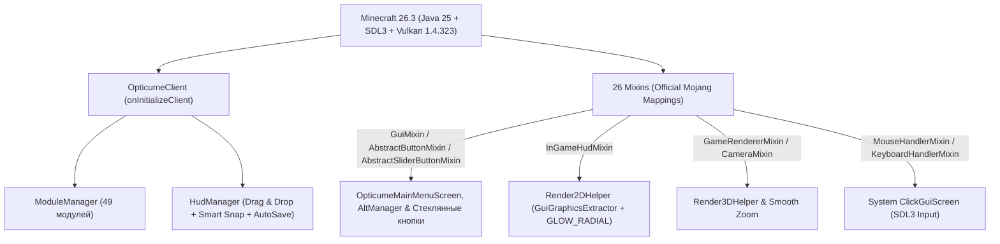

# 🌌 OpticumeClient (Minecraft 26.3 / Java 25 / Vulkan)

**OpticumeClient** — кастомный визуальный и вспомогательный клиентский мод для **Minecraft 26.3** (Game Drop 2026), разработанный под **Java 25**, **Fabric Loader 0.20.1**, **Fabric API 0.165.2+26.3** и графический стек **Sodium 0.9.3 + Vulkan 1.4.323 (RenderPearl / Blaze3D)**.

---

## ⚡ Быстрый старт

Все команды выполняются из корня репозитория:

```powershell
# 1. Проверить компиляцию (Java 25, 115 исходных файлов, авто-синхронизация src/ <-> src_26/)
python compile_check_26.py

# 2. Собрать JAR и задеплоить в тестовый инстанс лаунчера (%APPDATA%\ElyPrismLauncher\instances\OPTIMUSPRIME\minecraft\mods)
python deploy_26.py

# 3. Запустить полный набор автотестов (8/8 проверок)
python test_suite_26.py
```

* **Главное меню и AltManager:** кастомное меню в стиле **Desire** поверх живой панорамы Minecraft (плюс выдвижная **Gallery** для выбора обоев), рабочий оффлайн-переключатель ников **AltManager** и стеклянный стиль для всех ванильных кнопок и слайдеров игры.
* **Открыть ClickGUI в игре:** клавиша `Right Shift` (`Правый Shift`) — меню в стиле **System** со сворачиваемым сайдбаром, тёмной/светлой темой, поиском `Ctrl+F`, 3-колоночной сеткой карточек, страницами `Configs` / `Friends` и режимом `HUD Editor`.
* **Перетаскивание виджетов HUD (Drag & Drop):** откройте чат (`T`) или нажмите `HUD Editor` в ClickGUI.

---

## 🧭 Навигация по документации

| Файл | Назначение | Кто читает |
| :--- | :--- | :--- |
| [`README.md`](README.md) | Обзор проекта, быстрый старт, структура папок, таблицы всех модулей и миксинов | Человек, GitHub, IDE, ИИ |
| [`AGENTS.md`](AGENTS.md) | Главный свод правил, ограничений безопасности, архитектуры и пайплайна сборки | Antigravity, Codex, Windsurf, Copilot |
| [`CLAUDE.md`](CLAUDE.md) | Точка входа и инструкции для агентов Claude Code | Claude Code |
| [`.cursorrules`](.cursorrules) | Системные правила для IDE Cursor | Cursor AI |
| [`VISUAL_DATABASE.md`](VISUAL_DATABASE.md) | Полная визуальная база данных: палитры, координаты UI, рендер-пайплайн | Дизайнер / Разработчик |

---

## 📂 Структура директорий

```text
OpticumeClient/
├── src/                        # Основной исходный код (115 Java-файлов + 62 ресурса, синхронизирован с src_26/)
│   └── main/
│       ├── java/dev/opticumeclient/
│       │   ├── OpticumeClient.java         # Главная точка входа мода (ClientModInitializer, MOD_ID = opticumeclient)
│       │   ├── client/
│       │   │   ├── config/                 # ConfigManager (<gameDir>/opticumeclient/)
│       │   │   ├── friend/                 # FriendManager (<gameDir>/opticumeclient/friends.json)
│       │   │   ├── gui/                    # System ClickGUI (ClickGuiScreen, SystemTheme, SystemModuleCard, SystemSearchModal, SystemPages)
│       │   │   ├── hud/                    # HudManager (с автосохранением) и 4 HUD-модуля
│       │   │   ├── modules/                # 49 модулей по категориям + ModuleManager
│       │   │   ├── render/                 # Render2DHelper, Render3DHelper, TextureAssets, ThemeManager, Animation
│       │   │   ├── setting/                # Настройки модулей (Boolean, Number, Mode, MultiBox, Color)
│       │   │   └── ui/menu/                # Главное меню Desire, Gallery, оффлайн AltManager, OpticumeButtonStyle
│       │   └── mixin/                      # 26 Mixin-классов (Official Mojang Mappings, JAVA_25)
│       └── resources/
│           ├── fabric.mod.json             # Метаданные мода OpticumeClient (id: opticumeclient)
│           ├── opticumeclient.mixins.json  # Конфигурация 26 миксинов
│           └── assets/opticumeclient/      # Иконка (icon.png), локализации (en_us, ru_ru), иконки и обои
├── src_26/                     # Зеркало исходников для пайплайна сборки 26.3 (авто-синхронизируется с src/)
├── compile_check_26.py         # Скрипт проверки компиляции (javac --release 25 + авто-синхронизация)
├── deploy_26.py                # Скрипт упаковки JAR и деплоя в инстанс лаунчера
└── test_suite_26.py            # Автоматический тест-сьют (8/8 проверок)
```

> [!TIP]
> **Автоматическая синхронизация `src/` и `src_26/`:**  
> При запуске `python compile_check_26.py` (или `python deploy_26.py`) обе папки автоматически синхронизируются по времени модификации файла. При удалении или переименовании файлов удаляйте старые копии в обеих директориях.

---

## 🏗️ Архитектура рендеринга и управления



---

## 🧩 Полный список модулей (49 модулей)

| Категория | Кол-во | Модули |
| :--- | :---: | :--- |
| **COMBAT** | 8 | `LegitAuraModule`, `KillAuraModule`, `OpticumeAuraModule`, `TriggerBotModule`, `AimAssistModule`, `AutoTotemModule`, `ShieldBreakerModule`, `MiddleClickPearlModule` |
| **FRIENDS** | 1 | `MiddleClickFriendModule` *(плюс страница Friends в ClickGUI)* |
| **MOVEMENT** | 5 | `SprintModule`, `NoSlowModule`, `VelocityModule`, `NoPushModule`, `NoJumpDelayModule` |
| **VISUALS** | 23 | `PlayerEspModule`, `TargetEspModule`, `ViewModelModule`, `NameTagsModule`, `PopChamsModule`, `AmbienceModule`, `KillEffectModule`, `ItemEspModule`, `TracersModule`, `ChamsModule`, `JumpCirclesModule`, `ParticlesModule`, `ChinaHatModule`, `HitBubblesModule`, `ArrowsModule`, `FullbrightModule`, `HitColorModule`, `TrailsModule`, `CrosshairModule`, `TargetHudModule`, `CustomFontModule`, `NoRenderModule`, `ZoomModule` |
| **ANIMATIONS** | 1 | `OldAnimationsModule` |
| **OPTIMIZATION** | 7 | `LowFireModule`, `NoHurtCamModule`, `MemoryCleanerModule`, `EntityCullingModule`, `ChunkAnimatorModule`, `FastMathModule`, `FrameSyncModule` |
| **HUD** | 4 | `InfoHud`, `KeystrokesHud`, `ArmorHud`, `PotionHud` |

---

## ⚠️ Важные технические особенности Minecraft 26.3

1. **Официальные маппинги (Official Mojang Mappings):**
   * В Minecraft 26.3 обфускация удалена (`GuiGraphicsExtractor`, `DeltaTracker`, `PoseStack`, `Gui.setScreen`, без Intermediary и `refmap.json`).
2. **Ввод через SDL3:**
   * В `Screen.mouseClicked(MouseButtonEvent, boolean)` используются SDL3-коды (`1=LMB, 2=MMB, 3=RMB`), а скан-коды клавиатуры задаются через `InputConstants.KEY_*`.
3. **Ленивая инициализация `ItemStack`:**
   * Все `ItemStack` для иконок HUD создаются лениво, чтобы не вызывать `NullPointerException: Components not bound yet` в `<clinit>`.
4. **Изоляция лаунчера:**
   * Деплой выполняется **только** в тестовый инстанс `%APPDATA%\ElyPrismLauncher\instances\OPTIMUSPRIME\minecraft\mods\opticumeclient-26.3.jar`.
