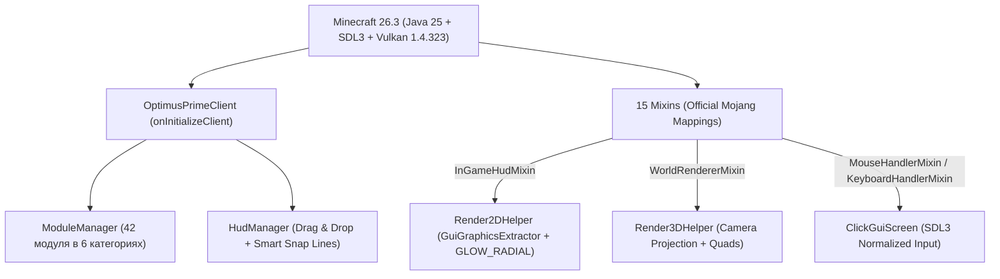

# 🌌 OpticumeClient (Minecraft 26.3 / Java 25 / Vulkan)

**OpticumeClient** — кастомный визуальный и вспомогательный клиентский мод для **Minecraft 26.3** (Game Drop 2026), разработанный под **Java 25**, **Fabric Loader 0.20.1**, **Fabric API 0.165.2+26.3** и графический стек **Sodium 0.9.3 + Vulkan 1.4.323 (RenderPearl / Blaze3D)**.

---

## ⚡ Быстрый старт (Для человека и ИИ)

Все команды выполняются из корня проекта (`c:\Users\User\Desktop\Projects\OPTIMUSPRIME`):

```powershell
# 1. Проверить компиляцию (Java 25, 86 исходных файлов, авто-синхронизация src/ <-> src_26/)
python compile_check_26.py

# 2. Собрать JAR и задеплоить в тестовый инстанс лаунчера (Optimus Prime Test)
python deploy_26.py

# 3. Запустить полный набор автотестов (7/7 проверок)
python test_suite_26.py
```

* **Открыть меню в игре:** клавиша `Right Shift` (`Правый Shift`).
* **Перетаскивание виджетов HUD (Drag & Drop):** откройте чат (`T`) и перетаскивайте любой виджет мышью (с магнитным выравниванием по сетке).

---

## 🧭 Навигация по документации (Для людей и любых ИИ-систем)

| Файл | Назначение | Кто читает |
| :--- | :--- | :--- |
| [`README.md`](file:///c:/Users/User/Desktop/Projects/OPTIMUSPRIME/README.md) | Обзор проекта, быстрый старт, структура папок, таблицы всех модулей и миксинов | Человек, GitHub, IDE, любые ИИ |
| [`AGENTS.md`](file:///c:/Users/User/Desktop/Projects/OPTIMUSPRIME/AGENTS.md) | Главный свод правил, ограничений безопасности, архитектуры и пайплайна сборки | Antigravity, OpenAI Codex, Windsurf, Cline, Copilot |
| [`CLAUDE.md`](file:///c:/Users/User/Desktop/Projects/OPTIMUSPRIME/CLAUDE.md) | Точка входа и инструкции для агентов Claude Code | Claude Code (`claude`) |
| [`.cursorrules`](file:///c:/Users/User/Desktop/Projects/OPTIMUSPRIME/.cursorrules) | Системные правила для IDE Cursor | Cursor AI |
| [`VISUAL_DATABASE.md`](file:///c:/Users/User/Desktop/Projects/OPTIMUSPRIME/VISUAL_DATABASE.md) | Полная визуальная база данных: палитры, координаты UI, шейдеры, рендер-пайплайн | Любой ИИ / Дизайнер / Разработчик |

---

## 📂 Структура директорий

```text
OPTIMUSPRIME/
├── src/                        # Основной исходный код (86 Java-файлов + ресурсы, синхронизирован с src_26/)
│   └── main/
│       ├── java/dev/optimusprime/
│       │   ├── OptimusPrimeClient.java     # Главная точка входа мода (ClientModInitializer)
│       │   ├── client/
│       │   │   ├── gui/ClickGuiScreen.java # Единое окно ClickGUI (Sidebar Window 660x430 + 3 режима)
│       │   │   ├── hud/                    # Менеджер HUD и 4 HUD-модуля (InfoHud, ArmorHud, PotionHud, KeystrokesHud)
│       │   │   ├── modules/                # 42 модуля по 6 категориям + ModuleManager + Settings
│       │   │   └── render/                 # Render2DHelper, Render3DHelper, TextureAssets, ThemeManager, Animation
│       │   └── mixin/                      # 15 Mixin-классов (Official Mojang Mappings, JAVA_25)
│       └── resources/
│           ├── fabric.mod.json             # Метаданные мода OpticumeClient
│           ├── optimusprime.mixins.json    # Конфигурация 15 миксинов
│           └── assets/optimusprime/        # Текстуры (firefly, glow, snowflake, star, heart, arrow)
├── src_26/                     # Зеркало исходников для пайплайна сборки 26.3 (авто-синхронизируется с src/)
├── build26/                    # Артефакты сборки: скомпилированные классы и build26/libs/optimusprime-26.3.jar
├── backups/                    # Единый чистый архив проекта: backups/OpticumeClient_backup.zip
├── reference_sources/          # Исходные референсы открытых клиентов (только для чтения/справки)
├── .agents/rules/              # Автоматические правила для агентов Antigravity
├── compile_check_26.py         # Скрипт быстрой компиляции (javac --release 25 + авто-синхронизация src/ и src_26/)
├── deploy_26.py                # Скрипт упаковки JAR и деплоя в тестовый инстанс лаунчера
└── test_suite_26.py            # Автоматический тест-сьют (7/7 проверок)
```

> [!TIP]
> **Автоматическая синхронизация `src/` и `src_26/`:**  
> Вы можете редактировать файлы как в `src/`, так и в `src_26/`. При запуске `python compile_check_26.py` (или `python deploy_26.py`) скрипт автоматически синхронизирует обе папки по дате последнего изменения файла (`mtime`).

---

## 🏗️ Архитектура рендеринга и управления



---

## 🧩 Полный список модулей (42 модуля)

| Категория | Кол-во | Модули |
| :--- | :---: | :--- |
| **COMBAT** | 8 | `LegitAuraModule`, `KillAuraModule`, `OptimusAuraModule`, `TriggerBotModule`, `AimAssistModule`, `AutoTotemModule`, `ShieldBreakerModule`, `MiddleClickFriendModule` |
| **MOVEMENT** | 2 | `SprintModule`, `NoSlowModule` |
| **VISUALS** | 21 | `PlayerEspModule`, `TargetEspModule` (*Ghosts / Soul*), `ViewModelModule`, `NameTagsModule`, `PopChamsModule`, `AmbienceModule`, `KillEffectModule`, `ItemEspModule`, `TracersModule`, `ChamsModule`, `JumpCirclesModule`, `ParticlesModule`, `ChinaHatModule`, `HitBubblesModule`, `ArrowsModule`, `FullbrightModule`, `HitColorModule`, `TrailsModule`, `CrosshairModule`, `TargetHudModule`, `CustomFontModule` |
| **ANIMATIONS** | 1 | `OldAnimationsModule` |
| **OPTIMIZATION** | 6 | `LowFireModule`, `NoHurtCamModule`, `MemoryCleanerModule`, `EntityCullingModule`, `ChunkAnimatorModule`, `FastMathModule` |
| **HUD** | 4 | `InfoHud` (*12 встроенных суб-виджетов*), `KeystrokesHud`, `ArmorHud`, `PotionHud` |

---

## ⚠️ Важные технические особенности Minecraft 26.3

1. **Официальные маппинги (Official Mojang Mappings):**
   * В Minecraft 26.3 обфускация удалена. Используются прямые имена классов и методов Mojang (`GuiGraphicsExtractor`, `DeltaTracker`, `PoseStack`, `KeyMapping`). Никаких Intermediary и `refmap.json`!
2. **Ввод мыши через SDL3:**
   * В `Screen.mouseClicked(MouseButtonEvent, boolean)` SDL3 передаёт коды кнопок `1=LMB, 2=MMB, 3=RMB`. В `ClickGuiScreen.normalizeMouseButton` они приводятся к `0=LMB, 1=RMB, 2=MMB`.
3. **Ленивая инициализация `ItemStack` (`Components not bound yet`):**
   * В Minecraft 26.3 вызов `Items.*.getDefaultInstance()` или `new ItemStack(...)` внутри `<clinit>` или конструкторов до завершения загрузки реестров выбрасывает `NullPointerException: Components not bound yet`. Все `ItemStack` для иконок HUD создаются лениво (см. `InfoHud.ensureStaticItemStacks()`).
4. **Строгая изоляция лаунчера:**
   * Деплой выполняется **только** в тестовый инстанс `C:\Users\User\AppData\Roaming\ElyPrismLauncher\instances\OPTIMUSPRIME\minecraft\mods\optimusprime-26.3.jar`.
