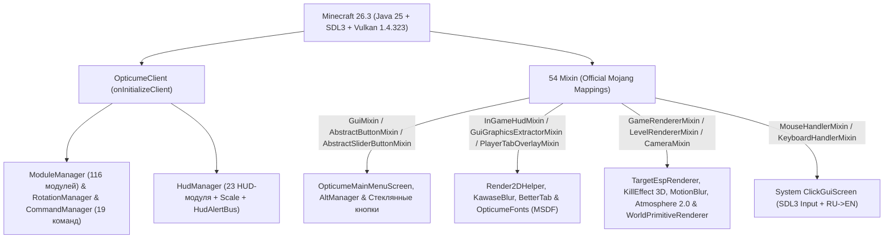

# 🌌 OpticumeClient (Minecraft 26.3 / Java 25 / Vulkan)

**OpticumeClient** (`v1.5.5-mc26.3`) — кастомный визуальный и вспомогательный клиентский мод для **Minecraft 26.3** (Game Drop 2026), разработанный под **Java 25**, **Fabric Loader 0.20.1**, **Fabric API 0.165.2+26.3** и графический стек **Sodium 0.9.3 + Vulkan 1.4.323 (RenderPearl / Blaze3D)**.

---

## ⚡ Быстрый старт

Все команды выполняются из корня репозитория:

```powershell
# 1. Проверить компиляцию (Java 25, 341 исходный Java-файл, авто-синхронизация src/ <-> src_26/)
python compile_check_26.py

# 2. Собрать JAR и задеплоить в тестовый инстанс лаунчера (%APPDATA%\ElyPrismLauncher\instances\OPTIMUSPRIME\minecraft\mods)
python deploy_26.py

# 3. Запустить полный набор автотестов (8/8 проверок)
python test_suite_26.py
```

* **Главное меню и AltManager:** кастомное меню в стиле **Desire** поверх живой панорамы Minecraft (плюс выдвижная **Gallery** для выбора обоев), рабочий оффлайн-переключатель ников **AltManager** и стеклянный стиль для всех ванильных кнопок и слайдеров игры.
* **Открыть ClickGUI в игре:** клавиша `Right Shift` (`Правый Shift`) — меню в стиле **System** со сворачиваемым сайдбаром / macOS Dock, тёмной/светлой темой, поиском `Ctrl+F`, 3-колоночной сеткой карточек, тултипами, страницами `Themes`, `Events`, `AutoBuy`, `Configs`, `Friends` и режимом `HUD Editor`.
* **Перетаскивание виджетов HUD (Drag & Drop):** откройте чат (`T`) или нажмите `HUD Editor` в ClickGUI (правый клик по виджету открывает настройки фона/стекла).

---

## 🧭 Навигация по документации

| Файл | Назначение | Кто читает |
| :--- | :--- | :--- |
| [`README.md`](README.md) | Обзор проекта, быстрый старт, структура папок, таблицы всех модулей и миксинов | Человек, GitHub, IDE, ИИ |
| [`CHANGELOG.md`](CHANGELOG.md) | Подробная история версий и исправлений по релизам | Человек, GitHub |
| [`AGENTS.md`](AGENTS.md) | Главный свод правил, ограничений безопасности, архитектуры и пайплайна сборки | Antigravity, Codex, Windsurf, Copilot |
| [`CLAUDE.md`](CLAUDE.md) | Точка входа и инструкции для агентов Claude Code | Claude Code |
| [`.cursorrules`](.cursorrules) | Системные правила для IDE Cursor | Cursor AI |
| [`VISUAL_DATABASE.md`](VISUAL_DATABASE.md) | Полная визуальная база данных: палитры, координаты UI, рендер-пайплайн | Дизайнер / Разработчик |

---

## 📂 Структура директорий

```text
OpticumeClient/
├── src/                        # Основной исходный код (341 Java-файл + 270 файлов ресурсов, синхронизирован с src_26/)
│   └── main/
│       ├── java/dev/opticumeclient/
│       │   ├── OpticumeClient.java         # Главная точка входа мода (ClientModInitializer, MOD_ID = opticumeclient)
│       │   ├── client/
│       │   │   ├── autobuy/                # Подсистема AutoBuy (движок, база предметов, парсер цен, автоселлер)
│       │   │   ├── bots/                   # Менеджер мульти-сессионных ботов (BotSessionManager, BotContext)
│       │   │   ├── combat/                 # Silent RotationManager (GCD, MoveFix Free/Focus) + neuro/ (GruRotationModel, NeuroDatasetRecorder)
│       │   │   ├── command/                # Клиентские команды Brigadier (19 команд, CommandFix RU->EN, .prefix, .macro, .way, .staff, .fakeplayer, .neuro, .script)
│       │   │   ├── config/                 # ConfigManager (<gameDir>/opticumeclient/, масштаб HUD scale)
│       │   │   ├── friend/                 # FriendManager (<gameDir>/opticumeclient/friends.json)
│       │   │   ├── gps/                    # GPS-метки, вейпоинты (.way) и кликабельные координаты в чате
│       │   │   ├── gui/                    # System ClickGUI, ViewModelEditorScreen (Bezier P1/P2), SystemSearchModal (RU->EN), ThemesPage, EventsPage, AutoBuyPage, SystemPages
│       │   │   ├── hud/                    # HudManager (scale + snap), HudAlertBus, HudPanelRenderer и 23 перетаскиваемых HUD-виджета
│       │   │   ├── modules/                # 116 модулей по 7 категориям + ModuleManager + пакеты visuals/targetesp, killeffect, ambience, atmosphere, hands
│       │   │   ├── render/                 # Render2DHelper, Render3DHelper, KawaseBlurRenderer, WorldPrimitiveRenderer, font/OpticumeFonts, TextureAssets, ThemeManager
│       │   │   ├── script/                 # ScriptManager — hot-reload движок клиентских скриптов (.oc)
│       │   │   ├── services/               # ServerEventsService, AnarchyReconnectService, media/ (SmtcBridge, LyricsService, CoverArtManager), network/ (ProxyManager), auth/ (MicrosoftOAuthService, BanTrackerStore), DiscordRpcService
│       │   │   ├── setting/                # Настройки модулей (Boolean, Number, Mode, MultiBox, Color, Bind, Run, Text + visibleWhen)
│       │   │   └── ui/                     # Главное меню Desire, Gallery, оффлайн AltManager, OpticumeButtonStyle, ScreenBots
│       │   └── mixin/                      # 54 Mixin-класса (Official Mojang Mappings, JAVA_25)
│       └── resources/
│           ├── fabric.mod.json             # Метаданные мода OpticumeClient (id: opticumeclient)
│           ├── opticumeclient.mixins.json  # Конфигурация 54 миксинов
│           └── assets/opticumeclient/      # Иконка, локализации, шрифты MSDF, шейдеры TargetESP/UI/PostFX, звуки и текстуры Desire, обои
├── src_26/                     # Зеркало исходников для пайплайна сборки 26.3 (авто-синхронизируется с src/)
├── CHANGELOG.md                # История версий и изменений
├── compile_check_26.py         # Скрипт проверки компиляции (javac --release 25 + авто-синхронизация)
├── deploy_26.py                # Скрипт упаковки JAR и деплоя в инстанс лаунчера
└── test_suite_26.py            # Автоматический тест-сьют (8/8 проверок)
```

> [!TIP]
> **Автоматическая синхронизация `src/` и `src_26/`:**  
> При запуске `python compile_check_26.py` (или `python deploy_26.py`) обе папки автоматически синхронизируются по времени модификации файла. При удалении или переименовании файлов удаляйте старые копии в обеих директориях.

---

## 🏗️ Архитектура рендеринга и управления



---

## 🧩 Полный список модулей (116 модулей)

| Категория | Кол-во | Модули |
| :--- | :---: | :--- |
| **COMBAT** | 18 | `LegitAuraModule` *(Silent/Client + Neuro GRU)*, `OpticumeAuraModule` *(Silent/Client + MoveFix + Neuro GRU)*, `TriggerBotModule`, `AimAssistModule`, `AutoTotemModule` *(TNT/Anchor/Mace/Trident + SaveEnchanted + SwapBack)*, `AutoSwapModule` *(Toggle/Wheel + Head Swap)*, `ShieldBreakerModule`, `AntiBotModule`, `NoFriendDamageModule`, `MiddleClickPearlModule`, `AutoCrystalModule`, `AutoAnchorModule`, `MaceHelperModule`, `BackTrackModule`, `HitBoxesModule`, `AutoPotionModule`, `TargetPearlModule`, `BowAimBotModule` |
| **FRIENDS** | 1 | `MiddleClickFriendModule` *(плюс страница `Friends` в ClickGUI и `.friend`)* |
| **MOVEMENT** | 16 | `SprintModule`, `NoSlowModule`, `VelocityModule`, `NoPushModule`, `NoJumpDelayModule`, `GuiMoveModule`, `AutoToolModule`, `ItemScrollerModule`, `NoWebModule`, `ElytraHelperModule`, `JesusModule`, `SpiderModule`, `NoFallModule`, `AirStuckModule`, `SpeedModule`, `SuperFireworkModule` |
| **VISUALS** | 41 | `PlayerEspModule`, `TargetEspModule` *(7 режимов Desire, 25 настроек)*, `ViewModelModule` *(+ ViewModelEditorScreen)*, `NameTagsModule`, `PopChamsModule`, `KillEffectModule` *(3D `Shatter / Dissolve / Soul / Ash` + `Hide Corpse`)*, `ItemEspModule`, `TracersModule`, `GlowEspModule`, `JumpCirclesModule` *(Desire Effect PostFX + 3D)*, `ParticlesModule`, `ChinaHatModule`, `HitBubblesModule`, `ArrowsModule`, `FullbrightModule`, `TrailsModule`, `CrosshairModule`, `SwingAnimationsModule` *(+ Bezier P1/P2 Editor)*, `CustomFontModule` *(MSDF)*, `ToggleSoundsModule`, `NoRenderModule`, `ZoomModule`, `PredictionsModule`, `AspectRatioModule`, `InterpolateF5Module`, `BlockOverlayModule`, `DamageTintModule`, `SeeInvisiblesModule`, `HandsModule`, `AmbienceModule` *(небо, время, туман, мокрые поверхности + Atmosphere 2.0 God Rays / 3D DDA / PostGrade)*, `FreeCamModule`, `FreeLookModule`, `ObjectInfoModule`, `BlockESPModule`, `TntTimerModule`, `PotsTimerModule`, `FireworkESPModule`, `ShulkerPreviewModule`, `ItemPhysicsModule`, `MotionBlurModule`, `BetterTabModule` |
| **OPTIMIZATION** | 5 | `LowFireModule`, `MemoryCleanerModule`, `EntityCullingModule`, `FrameSyncModule`, `VideoOptimizerModule` |
| **OTHER** | 12 | `AssistModule` *(Bundle + Shulker)*, `AutoBuyModule`, `BotsModule`, `AutoAcceptModule`, `LockSlotModule`, `NoInteractModule`, `ServerRPSpoofModule`, `AuctionHelperModule`, `NameProtectModule`, `PanicModule`, `CaptureBypassModule` *(Win32 JNA)*, `DiscordRpcModule` *(Win32 Named Pipe)* |
| **HUD** | 23 | `InterfaceModule`, `TargetHudModule`, `WatermarkHud`, `DynamicIslandHud` *(+ Music Mode & Karaoke)*, `ArrayListHud`, `StaffListHud`, `RadarHud`, `BpsGraphHud`, `TotemCounterHud`, `CoordinatesHud`, `NotificationsHud`, `KeystrokesHud`, `ArmorHud`, `PotionHud`, `CooldownsHud`, `BindsHud`, `InventoryHud`, `AutoBuyReportHud`, `ServerKeybindsHud`, `SchedulesHud`, `CustomHotbarHud`, `MediaPlayerHud`, `ProfilerHud` |

---

## ⚠️ Важные технические особенности Minecraft 26.3

1. **Официальные маппинги (Official Mojang Mappings):**
   * В Minecraft 26.3 обфускация удалена (`GuiGraphicsExtractor`, `DeltaTracker`, `PoseStack`, `Gui.setScreen`, без Intermediary и `refmap.json`).
2. **Ввод через SDL3:**
   * В `Screen.mouseClicked(MouseButtonEvent, boolean)` используются SDL3-коды (`1=LMB, 2=MMB, 3=RMB`), а скан-коды клавиатуры задаются через `InputConstants.KEY_*`.
3. **Ленивая инициализация `ItemStack`:**
   * Все `ItemStack` для иконок HUD создаются лениво, чтобы не вызывать `NullPointerException: Components not bound yet` в `<clinit>`.
4. **Изоляция лаунчера:**
   * Деплой выполняется **только** в тестовый инстанс `%APPDATA%\ElyPrismLauncher\instances\OPTIMUSPRIME\minecraft\mods\opticumeclient-26.3.jar`.
